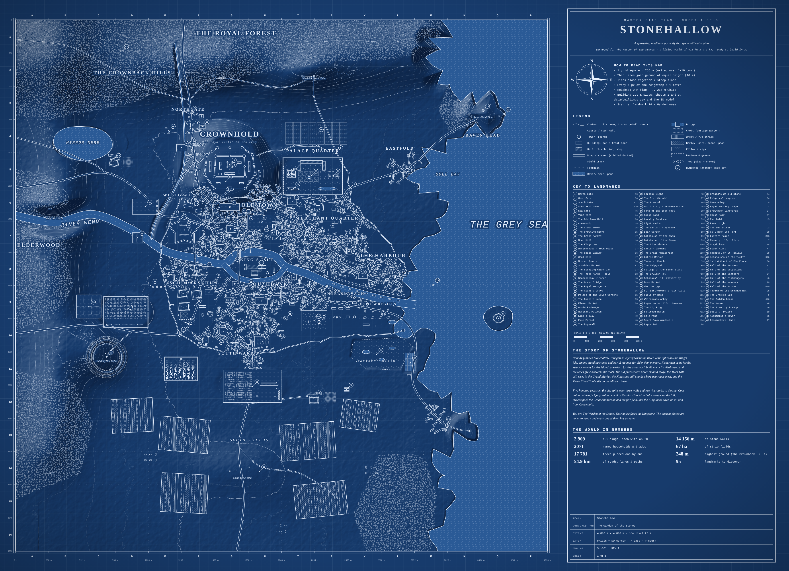

# How a Refrigerator Works – animated explainer

An ~11.5-minute animated lesson built with [Canvas Commons](https://canvascommons.io/) that explains the vapour-compression refrigeration cycle, with built-in "pause & think" quizzes and a final 6-question test.

**Video:** [`video/how-a-refrigerator-works.mp4`](video/how-a-refrigerator-works.mp4) (1920×1080, 30 fps, no audio)

## Contents
1. Intro – heat flows hot → cold by itself; a fridge moves it the other way using work
2. The sealed loop and its 4 parts, high- vs low-pressure sides, liquid/gas key
3. Evaporator · 4. Compressor · 5. Condenser · 6. Expansion valve (each with pressure/temperature meters and a quiz)
7. Energy balance: Qout = Qin + Win, COP
8. Myth buster: why an open fridge door warms the kitchen
9. Final test + summary

## Editing / re-rendering
```bash
npm install
npm start          # opens the Canvas Commons editor at http://localhost:9000
```
Press **RENDER** in the editor (image sequence → `output/`), then:
```bash
ffmpeg -framerate 30 -i output/how-a-refrigerator-works/%06d.jpeg \
  -c:v libx264 -crf 22 -pix_fmt yuv420p video/how-a-refrigerator-works.mp4
```

---

# Ashford Vale – a medieval world, ready to build in 3D


A complete 2 km × 2 km medieval valley in real metres: a moated hilltop castle guarded by a horseshoe of hills and watchtowers, a walled market town of 359 buildings, three villages, an abbey, mills, open-field farmland, forests, a river with bridges and an old ford, and a story to go with it. Every house has a named resident and trade.

**[Start here → `medieval-world/README.md`](medieval-world/README.md)**: a beginner's guide to reading the map and building the world in Blender, Unreal, Unity or Godot.

- `medieval-world/blueprints/`: master site plan plus castle and town detail sheets (SVG + PNG)
- `medieval-world/model/`: the whole world as a ready-to-import 3D blockout (`.glb`)
- `medieval-world/terrain/`: 16-bit heightmaps (1 px = 1 m) and 8 ground-cover masks
- `medieval-world/data/`: every building, tree, road, wall, field and landmark (JSON, CSV, catalogue)
- Rebuild after renaming places in `src/config.py`: `python3 medieval-world/build.py` (needs numpy and Pillow)

---

# Stonehallow – a sprawling medieval port-city that grew without a plan



A 4 km × 4 km map with an irregular, unplanned medieval city. Its zig-zag walls follow the land, organically grown lanes wander between sites, and a river splits around an island before reaching a rugged coast. There are 95 named places across 17 districts: a giant castle on a crag, a cathedral on the river island, 13 markets and fairs, an army camp and a star fort, an amphitheatre, a playhouse, a bear garden, a university, a shipyard, a ropewalk, dye works, a royal menagerie, a hedge maze, lighthouses, a sea fort, a salt marsh, forests and farmland. Nine small prehistoric places survive inside the medieval city: a mound in the market, a menhir at a crossroads, a dolmen, stone circles, a long barrow, a stone row, a holy well and a hillfort.

**[Start here → `medieval-city/README.md`](medieval-city/README.md)**: 5 blueprint sheets, a 3D blockout (`.glb`), 16-bit heightmaps, ground masks and full data, with steps for Blender, Unreal, Unity and Godot. Rebuild with `python3 medieval-city/build.py`.
