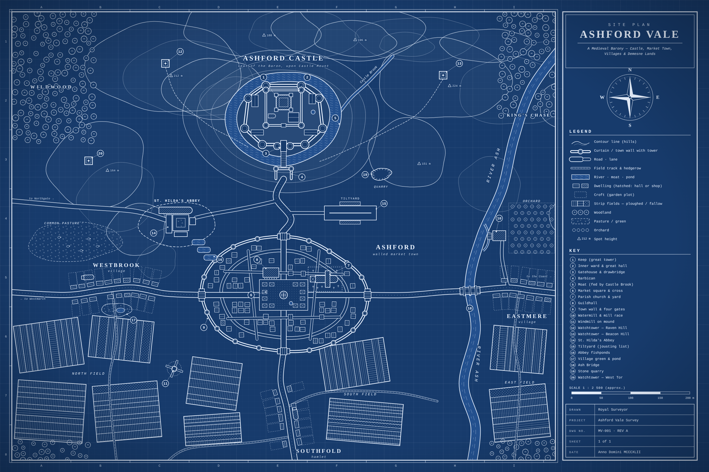

# How a Refrigerator Works – animated explainer

An ~11.5-minute animated lesson built with [Canvas Commons](https://canvascommons.io/) that explains the vapour-compression refrigeration cycle, with built-in "pause & think" quizzes and a final 6-question test.

**Video:** [`video/how-a-refrigerator-works.mp4`](video/how-a-refrigerator-works.mp4) (1920×1080, 30 fps, no audio)

## Contents
1. Intro – heat flows hot → cold by itself; a fridge moves it the other way using work
2. The sealed loop and its 4 parts, high- vs low-pressure sides, liquid/gas key
3. Evaporator · 4. Compressor · 5. Condenser · 6. Expansion valve (each with pressure/temperature meters and a quiz)
7. Energy balance: Qout = Qin + Win, COP
8. Myth buster: why an open fridge door warms the kitchen
9. Final test + summary

## Editing / re-rendering
```bash
npm install
npm start          # opens the Canvas Commons editor at http://localhost:9000
```
Press **RENDER** in the editor (image sequence → `output/`), then:
```bash
ffmpeg -framerate 30 -i output/how-a-refrigerator-works/%06d.jpeg \
  -c:v libx264 -crf 22 -pix_fmt yuv420p video/how-a-refrigerator-works.mp4
```

---

# Medieval Village – blueprint site plan



A blueprint-style site plan of a fictional medieval barony, **Ashford Vale**: a moated hilltop castle ringed by hills and watchtowers, a walled market town (market square, church, guildhall), the villages of Westbrook, Eastmere and Southfold, open-field strip farmland, the River Ash with a watermill and bridge, an abbey with fishponds, a tiltyard, a quarry, a windmill, pasture, an orchard and forests. It includes a legend, a numbered key, a compass rose, a scale bar and a title block.

- Vector: [`blueprints/medieval-village/medieval-village-blueprint.svg`](blueprints/medieval-village/medieval-village-blueprint.svg) (2400×1600)
- Raster: [`blueprints/medieval-village/medieval-village-blueprint.png`](blueprints/medieval-village/medieval-village-blueprint.png)
- Regenerate the SVG with `python3 blueprints/medieval-village/generate.py` (no dependencies)
