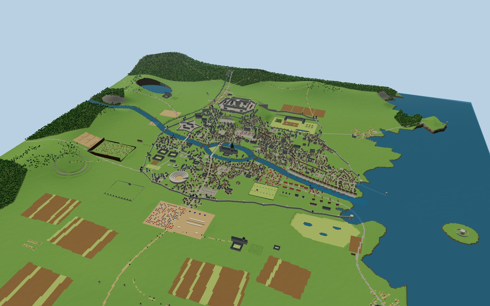
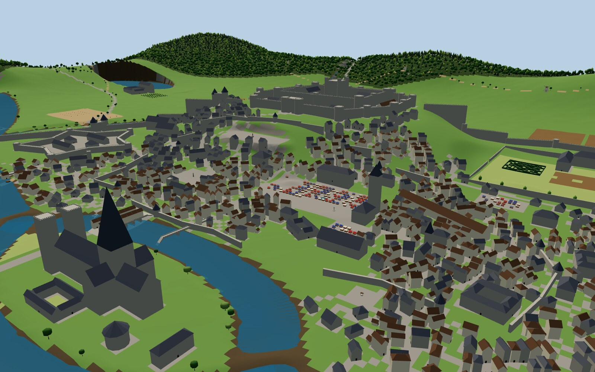
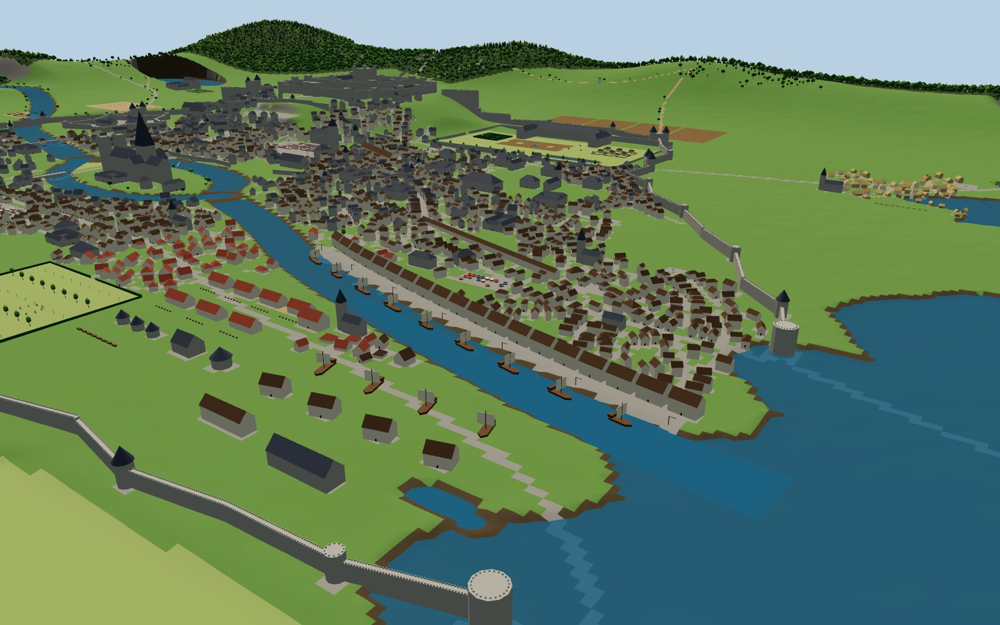
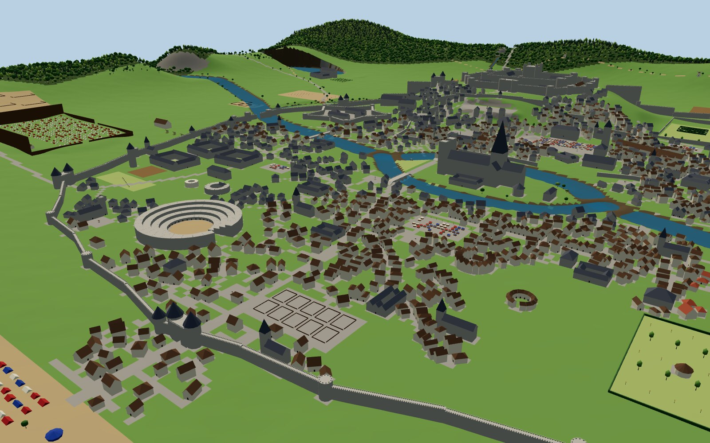

# Stonehallow: a sprawling medieval port-city that grew without a plan


Stonehallow is a big, irregular medieval city on a **4 km × 4 km** map (16.8 km² in real metres),
built for exploring. Nobody planned it, so nothing is a circle or a grid:

- **Zig-zag walls** follow the hills and the river, and the castle closes the circuit on its crag.
- **Lanes grow organically**: they wander, branch, dead-end and join like the roots of a tree.
- **The geography is varied**: a river that splits around an island in the middle of the city, a rugged
  coastline with a headland, a bay, a salt marsh, a sea fort on an island, hills, a lake and forests.
- **Variety over volume**: almost 100 named places across 17 districts. Each has its own
  character, and most streets lead somewhere worth going.
- **Nine small prehistoric places** survive inside the medieval city: a burial mound in the
  market, a menhir at a crossroads, a dolmen on the cathedral lawn, a tiny stone circle in the
  pleasure gardens, and more. Each one is drawn at large scale on its own sheet.

| | |
|---|---|
|  |  |
|  |  |

---

## What's in the city (by district)

| District | What you'll find |
|---|---|
| **Crownhold & Castlegate** | The giant castle on its crag: two curtain walls (20 m and 26 m), 26 towers, a 50 m keep, the Great Hall of the Kings, royal apartments, mint, armoury, barracks, stables, **the Crowning Stone**. Below it are Muster Square, the Arsenal and the Armourers' Hall |
| **Old Town** | The oldest, densest maze of lanes, inside a half-demolished first wall. **The Grand Market** with **Moot Hill** (a Bronze Age mound) in its corner, the Guildhall, the Town Hall and Belfry, the **Spice Bazaar** (a 160 m covered street), Wool Hall, Shambles Market, **the Kingstone** menhir and **your house**, the Sleeping Giant inn, a nunnery, a jail and court, the Goldsmiths' and Clockmakers' halls |
| **King's Isle** | An island in the river: **Stonehallow Minster** (120 m spire), cloister, chapter house, Bishop's Palace, and **the Three Kings' Table** dolmen. The **Grand Bridge** crosses both arms of the river, and its north span is lined with shops |
| **Palace Quarter** | **Palace of the Seven Gardens**: hedge maze, parterres, orchard, water-garden canal, lime walk, a **royal menagerie** and **the Giant's Grave** long barrow. Also nobles' townhouses, the Flower Market, and vineyards on the hill beyond the wall |
| **Merchant Quarter** | Grain Exchange, four courtyard **merchant palaces**, the Money-changers' Hall, the Mercers' and Vintners' halls, Blackfriars |
| **Harbour** | **King's Quay** with warehouses, treadwheel cranes and cogs, the Fish Market, Custom House, the 300 m **Ropewalk**, the Sailors' Chapel, a breakwater with **Harbour Light**, sea towers, and the Mermaid and Drowned Rat taverns |
| **Shipwrights' & Tanners' Reach** | **The shipyard** (four ships on the slipways, a sail loft, naval arsenal and mast pond). Tanneries, **dye works in three colours**, brick kilns, a bell foundry, glassworks and a brewery |
| **Southbank** | The round **Lantern Playhouse**, the **Bear Garden**, the **Night Market** under lanterns, two bathhouses, **Lantern Gardens** with **the Nine Sisters** stone circle, the Weavers' Hall, a debtors' prison and the Crooked Cup |
| **South Ward** | **The Great Auditorium**, a stone amphitheatre for 8,000 people, plus the Cattle Market, almshouses, the Masons' Hall and the Golden Goose |
| **Scholars' Hill** | Three colleges, the University Library, the **Hall of Disputations**, an **anatomy theatre**, an **observatory tower**, the Physic Garden, the Book Market, **the Druids' Row** stone row, the Hospital of St. Brigid, and the West Bridge with its mills |
| **Westgate (military)** | **The Star Citadel** (a five-pointed bastioned fort guarding the river), the Drill Field and archery butts, Greyfriars, the Alchemist's Tower, and the Horse Fair outside the gate |
| **Outside the walls** | **Camp of the Iron Host** (2,000 soldiers in tents, horse lines and a palisade), the Siege Yard with trebuchets, cavalry paddocks, **St. Bartholomew's Fair Field** (tents, pavilions, stages, a jousting tiltyard, archery, a maypole), the Field of Rest cemetery, Whitecross Abbey with beehives, the Leper House, **the Old Ring** Iron Age hillfort, Saltreed Marsh, salt pans, windmills, three farming hamlets and wide strip fields |
| **North & coast** | Northgate suburb with the Haymarket, the Pilgrims' Hospice and **Brigid's Well & Stone**. Mirror Mere and Mere Abbey, the Royal Forest and the King's hunting lodge, hill windmills and charcoal burners. **Eastfold** fishing village (stilt huts, drying racks, boats), **Raven Head** cliffs with Raven Light and **the Sea Stones**, the **Gull Rock Sea Fort**, and **Lantern Point** smugglers' village and lighthouse |

**Markets & fairs:** the Grand Market, Spice Bazaar, Wool Hall, Shambles, Grain Exchange, Fish
Market, Flower Market, Night Market, Cattle Market, Book Market, Haymarket, Horse Fair and
St. Bartholomew's Fair.

**The ancient places** (sheet 5): Moot Hill · the Kingstone · the Three Kings' Table · the Giant's
Grave · the Nine Sisters · the Druids' Row · the Old Ring · Brigid's Well & Stone · the Sea Stones.

---

## What's in the box

| Folder / file | What it is |
|---|---|
| `blueprints/01_master_site_plan` (.svg/.png) | The whole map with all 95 numbered places, legend, story and statistics |
| `blueprints/02_castle_and_old_town` | Crownhold and the Old Town at large scale, every building numbered |
| `blueprints/03_harbour_and_shipyard` | Quays, ropewalk, shipyard, Tanners' Reach and Lantern Gardens |
| `blueprints/04_isle_southbank_westgate` | King's Isle, Southbank, the Auditorium, Scholars' Hill and the Citadel |
| `blueprints/05_ancient_places` | Gazetteer: each prehistoric place drawn 200 m square |
| `model/stonehallow_blockout.glb` | **The whole map in 3D**: terrain, sea, river, walls, every building, props and trees |
| `model/stonehallow_preview.glb` | A lighter version for quick looks |
| `terrain/heightmap_4097.png` / `.r16`, `heightmap_4033_unreal.png` | 16-bit heightmaps, 1 pixel = 1 metre, 0–256 m, **sea level 20 m** |
| `terrain/masks/*.png` | 8 ground masks (grass, meadow, farmland, forest floor, rock, mud/sand, dirt road, cobblestone) |
| `data/world.json`, `buildings.csv`, `trees.csv`, `landmarks.csv`, `CATALOG.md` | Every place, building, stone, stall, tent, street, wall, tree and landmark |
| `viewer/index.html`, `build.py`, `src/` | Browser viewer and the generator |

Monuments and named buildings are separate objects in the 3D file. Ordinary houses are merged per
grid square so it stays fast; every house is still listed individually in `data/buildings.csv`.

---

## Building it in your engine

| Setting | Value |
|---|---|
| World | 4096 m × 4096 m |
| Heightmap | `terrain/heightmap_4097.png`, 16-bit, 4097 × 4097, 1 m per pixel |
| Heights | 0 m (black) to 256 m (white). **Put a water plane at 20 m for the sea** |
| Sanity check | The **Crown Tower** (keep) stands at map x 1650, y 1115 on the 118 m crag. **Your house** is at x 1657, y 1658 |

- **Blender:** `File → Import → glTF 2.0` → `model/stonehallow_blockout.glb`. The sea is included as a plane.
- **Unreal Engine 5:** drag in the `.glb`. For a Landscape, import `heightmap_4033_unreal.png` at
  **Location (0, 0, 12800)**, **Scale (101.59, 101.59, 50)**, then add a water plane at Z = 2000 cm.
  Map `(x, y, z)` m → Unreal `(x·100, y·100, z·100)` cm.
- **Unity:** add the **glTFast** package to import the `.glb`. For a Terrain: size 4096 × 256 × 4096,
  heightmap resolution 4097, *Import Raw* `heightmap_4097.r16` (16-bit, Windows). **Check north:** the
  castle should be near the far end (Z ≈ 2900); if it's at the near end, re-import with **Flip
  Vertically**. Map → Unity `(x, z, 4096 − y)`, rotation Y = heading.
- **Godot 4:** drag in the `.glb`. Map → Godot `(x, z, y)`, rotation.y = −heading (radians).

**Placing your own models:** build each model with its front door facing north at rotation 0 and its
pivot at the centre of its floor, then use the `x, y, z, heading, w, d, h` columns of `buildings.csv`
(Blender `(x, −y, z)` with Z = −heading; Unreal `(x·100, y·100, z·100)` with Yaw = heading).

**Reading the blueprints:** columns A–P and rows 1–16 make **256 m squares**. Contours are every
10 m on the master sheet and every 1 m on the detail sheets; lines close together mean steep ground.
Hachured rings and ovals are prehistoric earthworks, and black marks are standing stones. Hatched
rectangles are monuments and public buildings. A dot shows which way a front door faces.

---

## The story of Stonehallow

Nobody planned Stonehallow. It began as a ferry where the River Wend splits around King's Isle,
among standing stones and burial mounds far older than memory. Fishermen came for the estuary,
monks for the island, a warlord for the crag. Each built where it suited them, and the lanes
grew between them like roots. The old places were never cleared away. Moot Hill still rises in
the Grand Market, the Kingstone still stands where two roads meet, and the Three Kings' Table
sits on the Minster lawn.

Five hundred years on, the city spills over three walls and both riverbanks to the sea. Cogs
unload at King's Quay, soldiers drill at the Star Citadel, scholars argue on the hill, crowds pack
the Great Auditorium and the fair field, and the King looks down on all of it from Crownhold.

You are **the Warden of the Stones**. Your house faces the Kingstone. The ancient places are yours
to keep, and every one of them has a secret.

**Quest hooks:**
- **The Moot Hill Summons.** Someone has called an assembly on the mound at midnight. Nobody admits to it.
- **The Menagerie Breakout.** The palace lions are loose in the Merchant Quarter.
- **Ropewalk Fire.** 300 m of hemp and tar, and someone wants it burned before the fleet sails.
- **The Iron Host.** The army camp is restless; their pay is three months late and the Mint is next door.
- **The Ninth Sister.** One stone of the Nine Sisters has been replaced by a fake. Where is the real one?
- **The Druids' Row.** The astronomers say the row points somewhere other than the sunrise.
- **Gull Rock.** The sea fort has stopped answering signals from Harbour Light.
- **Fair Day.** St. Bartholomew's Fair opens tomorrow: 400 tents, a tournament and a dozen pickpockets.
- **The Old Ring.** The hermit inside the hillfort has stopped coming down for bread.
- **The Alchemist's Tower.** Green smoke, a missing apprentice, and a strange purchase of salt from the pans.

---

## Make it yours

Every name lives in `src/config.py`, including the city, the castle, the palace, the river, the
sea, the forests and **you**. The layout (where every district and site sits) is in
`src/layout.py`, written in plain metres. To rebuild:

```bash
pip install numpy pillow
python3 build.py        # about 3 minutes
```

`SEED` reshuffles how the lanes grow, and with them the houses, residents and trees.
