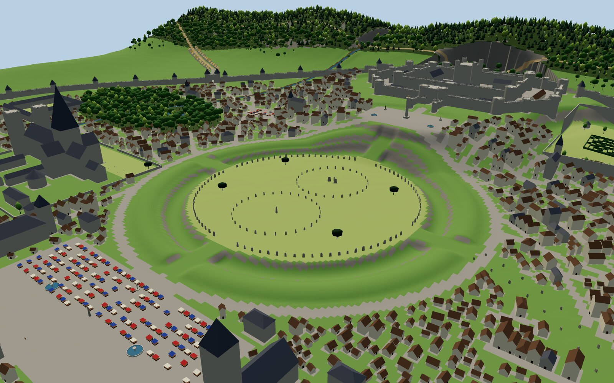
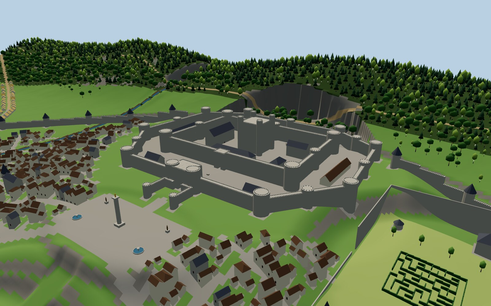
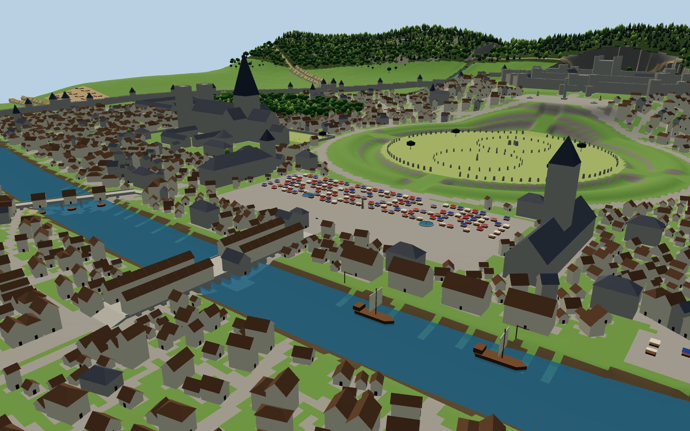

# Stonehallow: a crowded medieval city around the oldest stones in the world

*The crowned city that grew around the oldest stones in the world.*


Stonehallow is a great walled medieval city, **2 km × 2 km** in real metres, packed with
**4,437 buildings** and **3,400 named residents**. At its heart, untouched for four thousand years, stands
**the Hallowstones**: a prehistoric henge with a ditch, a bank and about 150 standing stones. The
medieval city has grown right up to its edge but never over it. Around it rise a giant concentric
castle on a crag, a 120 m cathedral spire, a cloth hall with an 84 m belfry, an inhabited bridge
lined with shops, great markets, royal gardens with a hedge maze, a wild woodland park inside the
walls, and forests on the hills beyond.

| | |
|---|---|
|  |  |
|  |  |

*Screenshots of the included 3D blockout model, which is built from the same data as the blueprints.*

---

## What's in the city

| | |
|---|---|
| **Prehistoric (preserved)** | The Hallowstones henge: a 420 m earthwork ring, ditch 7.5 m deep, bank 5 m high, the 88-stone Great Circle, the North Circle with **the Cove**, and the South Circle with **the Obelisk** · **the Serpent Avenue** (44 paired stones running 600 m to the river) · **the Giant's Barrow** (120 m chambered long barrow) · **the Druids' Row** stone row · **the Three Kings' Table** dolmen · **the Field of Mounds** (7 burial mounds) · **the Needle**, a 9 m menhir standing in the market · **the Crowning Stone** inside the castle |
| **Giant castle** | **Crownhold**: two rings of curtain walls (18 m and 24 m high) with 24 towers, a twin-drum great gatehouse, a barbican, a 46 m keep (the Crown Tower), the Great Hall of the Kings, royal apartments, a chapel, a treasury, a mint, an armoury, barracks and stables. It sits on a 118 m crag with cliffs to the north |
| **Monuments & architecture** | Stonehallow Minster (200 m long, 120 m spire, cloister, chapter house, Bishop's Palace) · the Cloth Hall & Belfry · the Great Guildhall · 8 guild halls · 13 parish churches · the King's Column (32 m, gilded statue) · statues and fountains · Whitecross Abbey · two friaries · the Hospital of St. Brigid · the Collegium of the Seven Stars (two colleges and a library) |
| **Markets** | **The Grand Market** (260 × 120 m, 150 stalls, two fountains, the Needle) · Haymarket · Fish Market on King's Quay · Corn Market · a Cattle Fair and a Horse Fair outside the gates. There are 202 stalls in all |
| **River life** | River Wend, 56 m wide · **the Old Bridge** (150 m, 19 arches, 28 shops and houses, and a chapel standing on it) · Mill Bridge with three corn mills · King's Quay with warehouses, cranes and sea-going cogs · two water gates closed by chains |
| **Gardens & nature** | The Queen's Gardens (summer palace, parterres, lime avenues, ponds and a 60 m **hedge maze**) · **King's Park** (wild woodland inside the walls, with a mere and the Giant's Barrow) · the Minster green with yews · the Physic Garden · the Royal Forest across the Crownback Hills · Thornwood and Elderwood · 7,200 trees |
| **The crowd** | 189 streets and lanes in a spider's web of ring roads and radial lanes. Terraced houses up to 5 storeys line every street, and the backs of the blocks are packed with tenements, workshops, stables and storehouses reached by narrow alleys. Every building has an ID, and most have a named resident and one of 51 trades |
| **Defences** | A 5 km city wall, 12 m high, with 46 towers, 7 gatehouses, 2 water gates and a dry ditch |

---

## What's in the box

| Folder / file | What it is |
|---|---|
| `blueprints/01_master_site_plan` (.svg/.png) | The whole city with contours, every building, 37 numbered landmarks, legend, story and statistics |
| `blueprints/02_crownhold_castle` | The castle at large scale, every building numbered and sized |
| `blueprints/03_hallowstones` | The prehistoric precinct, every stone drawn at true size, earthworks shown with hachures |
| `blueprints/04_market_minster_bridges` | The Grand Market, the Minster close, the Old Bridge and Mill Bridge |
| `model/stonehallow_blockout.glb` | **The whole city as one 3D file**: terrain, walls, monuments, all 4,437 buildings, bridges, ships, stones, stalls and trees |
| `model/stonehallow_preview.glb` | A lighter version for quick looks and slower computers |
| `terrain/heightmap_2049.png` / `.r16` / `heightmap_2017_unreal.png` | 16-bit heightmaps, 1 pixel = 1 metre, 0–256 m |
| `terrain/masks/*.png` | 8 ground masks: grass, meadow, farmland, forest floor, rock, mud, dirt road, cobblestone |
| `data/world.json`, `buildings.csv`, `trees.csv`, `landmarks.csv`, `CATALOG.md` | Every building, stone, stall, street, wall, tree and landmark, with positions in metres |
| `viewer/index.html` | A small browser 3D viewer |
| `build.py`, `src/` | The generator: rename things in `src/config.py` and rebuild |

**How buildings are organised in the 3D file:** monuments and named buildings (castle buildings,
churches, halls, colleges, gatehouses, towers, bridge houses) are **separate objects**, each named
with its ID. The ~4,200 ordinary houses, tenements and workshops are **merged into one object per
128 m grid square** (for example "East Ward - houses in square L8"), so the file stays fast to open.
Every one of them is still listed individually in `data/buildings.csv` with its exact position,
size, height, facing, resident and trade. That's what you use to replace them with real house
models (see "Placing your own models" below).

---

## The 5-minute start

**Blender:** `File → Import → glTF 2.0` → `model/stonehallow_blockout.glb`. Open the Outliner. Under
`Buildings` you'll find each district; under `Props & monuments` you'll find the henge stones,
the market stalls, the Needle, the King's Column and more. Select any object and press `Numpad .`
to fly to it. Monument and named buildings carry their catalogue data under
*Object Properties → Custom Properties*.

**Unreal / Unity / Godot:** see the engine steps below. The numbers are the same as for every
heightmap in this repo.

---

## How to read the blueprints

- **Grid:** columns **A–P**, rows **1–16**; each square is **128 m**. The key gives each landmark's square.
- **Contours** every 5 m on the master plan (bold every 25 m) and every 1 m on the detail sheets.
  Lines close together mean steep ground.
- **Hachures** (short ticks) show the prehistoric earthworks. Bold ticks are the henge ditch,
  light ticks the bank. Mounds are dotted ovals with ticks round the edge.
- **Black marks** in the henge and along the avenue are the standing stones. The detail sheet
  draws them at true size.
- **Rectangles** are buildings at their real footprint, with **hatching** for monuments and
  public buildings. On the detail sheets a **dot** marks each front door and the number is the
  building's ID.
- **Positions:** metres from the north-west corner; **x** east, **y** south. The **heading** is
  the compass direction a front door faces (0 = north, 90 = east).

---

## Building it in your engine

| Setting | Value |
|---|---|
| World | 2048 m × 2048 m |
| Heightmap | `terrain/heightmap_2049.png`, 16-bit, 2049 × 2049, 1 m per pixel |
| Height range | 0 m (black) to 256 m (white); the ground runs from about 64 m to 218 m |
| Sanity check | **The Crown Tower** (keep) is at map x 1024, y 392, floor 117.7 m. **Your house**, the Wardenhouse, is at x 787, y 819 |

**Blender:** import the `.glb`. For a full-detail terrain instead: add a Grid (1024 subdivisions,
size 2048), add Subdivision Surface (Simple, 1) and Displace (`heightmap_2049.png`, Non-Color,
Strength 256, Midlevel 0, Coordinates UV).

**Unreal Engine 5:** drag the `.glb` into the Content Browser. For a Landscape: import
`heightmap_2017_unreal.png` with **Location (0, 0, 12800)** and **Scale (101.59, 101.59, 50)**.
Unreal's X = east and Y = south, the same as the map, so a data point `(x, y, z)` in metres
goes to `(x·100, y·100, z·100)` cm. Create one landscape layer per mask in `terrain/masks/`.

**Unity:** add the **glTFast** package (`com.unity.cloud.gltfast`) to import the `.glb`. For a
Terrain: width/length 2048, height 256, resolution 2049, then *Import Raw*
`heightmap_2049.r16` (16-bit, Windows byte order). **Check north:** Crownhold must be at the
far end (Z ≈ 1630) and the Grand Market nearer (Z ≈ 850). If they're swapped, re-import with
**Flip Vertically**. Map → Unity: `position = (x, z, 2048 − y)`, `rotation Y = heading`.

**Godot 4:** drag the `.glb` into a scene (`position = (x, z, y)`, `rotation.y = −heading` in
radians). For a terrain, use the Terrain3D add-on with a height scale of 256.

### Placing your own models
Make each model with its **front door facing north** at rotation 0 and its pivot at the
**centre of its floor**. Then, for each row of `data/buildings.csv`:

| Engine | Position | Rotation |
|---|---|---|
| Blender | `(x, −y, z)` | Z = −heading |
| Unreal | `(x·100, y·100, z·100)` cm | Yaw = heading |
| Unity | `(x, z, 2048 − y)` | Y = heading |
| Godot / glTF | `(x, z, y)` | Y = −heading (radians) |

Use `w` × `d` for the footprint, `h` for the wall height, `roof`/`roof_h` for the roof and
`floors` for the storeys. Buildings standing on a bridge have their `z` set to the bridge deck.
Standing stones are listed in `world.json → props` with their own width, depth, height and lean.
Walls are lists of straight segments, ready for a spline or modular-wall tool.

---

## The story of Stonehallow

> *Four thousand years before any king, people raised the Hallowstones.*

**The Builders.** Long before iron or writing, the people of the valley dug a ditch 7 m deep with
antler picks and heaped the chalk into a great bank, a ring 420 m across. Inside it they raised a
circle of 98 stones, and inside that two smaller circles: one around **the Cove**, three giant
slabs where the dead were spoken to, and one around **the Obelisk**, whose shadow marks
midsummer noon. A double row of stones, **the Serpent Avenue**, winds down to the river.
They buried their chieftains in **the Giant's Barrow** and **the Field of Mounds**. Then they
vanished. The stones stayed.

**The Stone Peace.** People never stopped coming to the stones. Traders met at the henge gates,
and a fair became a market, the market a town, the town a city. When the first king took the
crag above, he knelt in the Cove and swore **the Stone Peace**: no one may break, move or build
upon the old stones, on pain of death. Every king since has sworn it again, crowned on
**the Crowning Stone**, a slab carried up from the henge to **Crownhold**.

**The City.** Because no one could build on the stones, the city grew around them. The streets
make a spider's web whose centre is the henge. **The Needle**, a menhir too big to move, was
simply left standing, and **the Grand Market** grew up around it. Merchants seal their bargains by
touching it. **Stonehallow Minster** was built facing the henge "so that the new faith may keep
an eye on the old". Its bishops have never quite managed to forbid the midsummer dancing on the
Hallow Green.

**Today.** The city is rich and loud and crowded. Cogs from across the sea unload at **King's
Quay**, and the Belfry rings the hours over the **Cloth Hall**. Shopkeepers lean out of their
windows over the river on **the Old Bridge**. Scholars argue in the **Collegium of the Seven
Stars**, the Queen gets lost in her own maze, and in the middle of it all sheep graze between
silent stones that are older than every name in the city.

**You** are **the Warden of the Stones**, keeper of the Stone Peace. Your house, the
**Wardenhouse**, stands at the henge's west entrance. Kings answer to the Peace, and so the Peace
answers to you.

---

## A first walk & quest hooks

**The Warden's round (about 5 km):**
1. Start at the **Wardenhouse (11)** and walk through the west entrance of **the Hallowstones (7)**,
   past **the Cove (8)** and **the Obelisk (9)**.
2. Leave by the north causeway to **Crown Square** and **the King's Column (20)**, then climb to
   **Crownhold (1)**: through **King's Gate (5)**, past **the Crowning Stone (4)** and up **the Crown Tower (2)**.
3. Walk east to **the Queen's Gardens (29)** and find the middle of **the Maze (28)**.
4. Go back round the Stone Ring and follow **the Serpent Avenue (10)** down to **King's Quay (26)** and
   **the Fish Market (22)**.
5. Take the **Grand Market (16)** (touch **the Needle (17)**), then cross **the Old Bridge (24)** to the
   **Corn Market (23)** and **the Field of Mounds (15)**.
6. Come back over **Mill Bridge (25)** to **Stonehallow Minster (27)** and **the Three Kings' Table (14)**,
   then through **King's Park (30)** to **the Giant's Barrow (12)**, and home.

**Quest hooks:**
- **The Moved Stone.** At dawn, one stone of the Great Circle stands a hand's breadth from its socket. Who
  dared break the Stone Peace, and how?
- **The Bishop's Petition.** The Minster wants the midsummer dancing banned. The guilds want it to stay.
- **The Needle's Debt.** A merchant swears he never touched the Needle to seal his deal. Witnesses disagree.
- **Under the Barrow.** Builders in King's Park broke into a passage. The Giant's Barrow has a back door.
- **The Sinking Bridge.** One of the Old Bridge's 19 piers is cracking under 28 houses.
- **The Lost Princess.** The Queen's youngest went into the maze at noon and hasn't come out.
- **Plague Ship.** A cog at King's Quay flies a yellow flag. The Hospital of St. Brigid has room for twelve.
- **The Avenue's End.** The Serpent Avenue's last stone stands in the river at low water. What is it pointing at?

---

## Make it yours

Every name lives in `src/config.py`, including the city, the castle, every monument, the markets, the
river and **you** (`YOU`, `YOUR_HOUSE`). Change them, then:

```bash
pip install numpy pillow
python3 build.py      # about a minute: rewrites blueprints, terrain, data and 3D models
```

`SEED` reshuffles houses, residents and trees. The layout itself (where the castle, henge, markets
and gardens sit) is in `src/layout.py`, written in plain metres.

Blueprint PNGs are rendered from the SVGs; open an `.svg` in a browser for a crisp, zoomable version.
