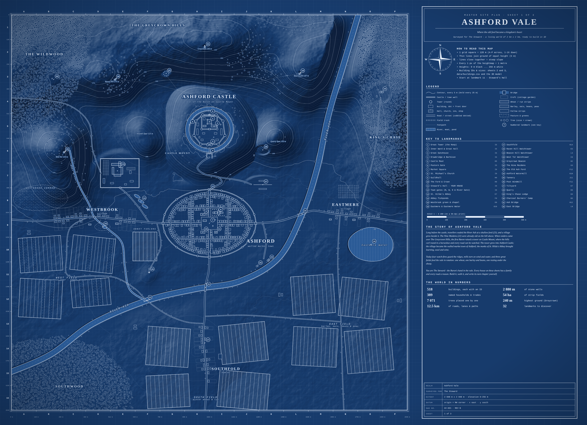
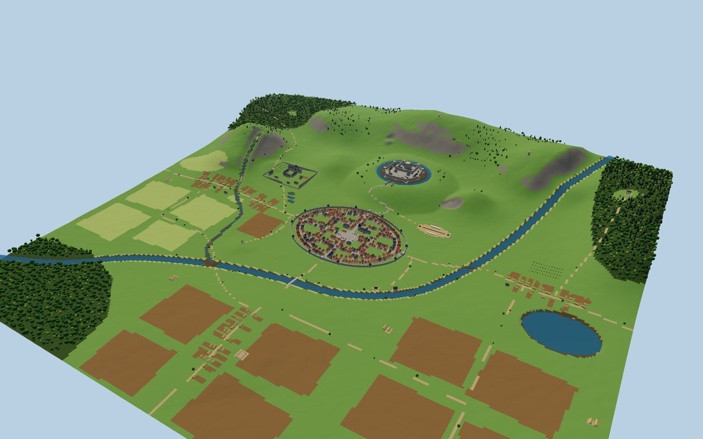
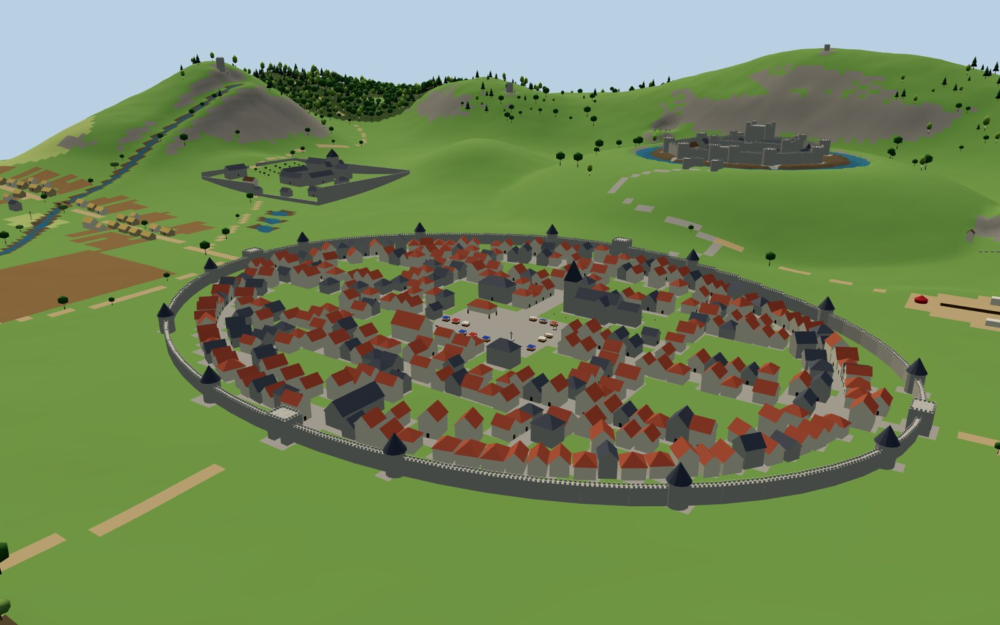
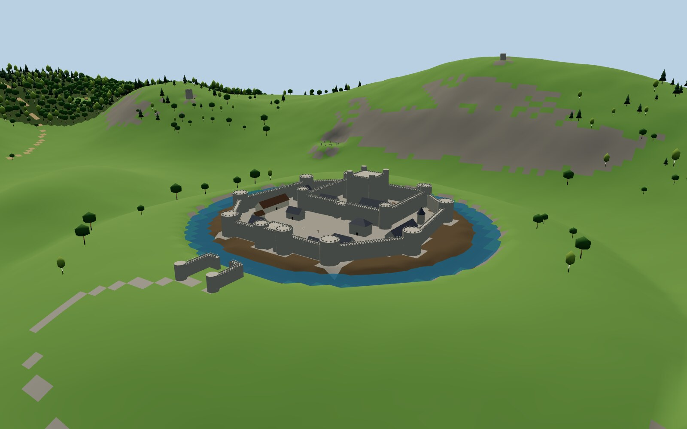
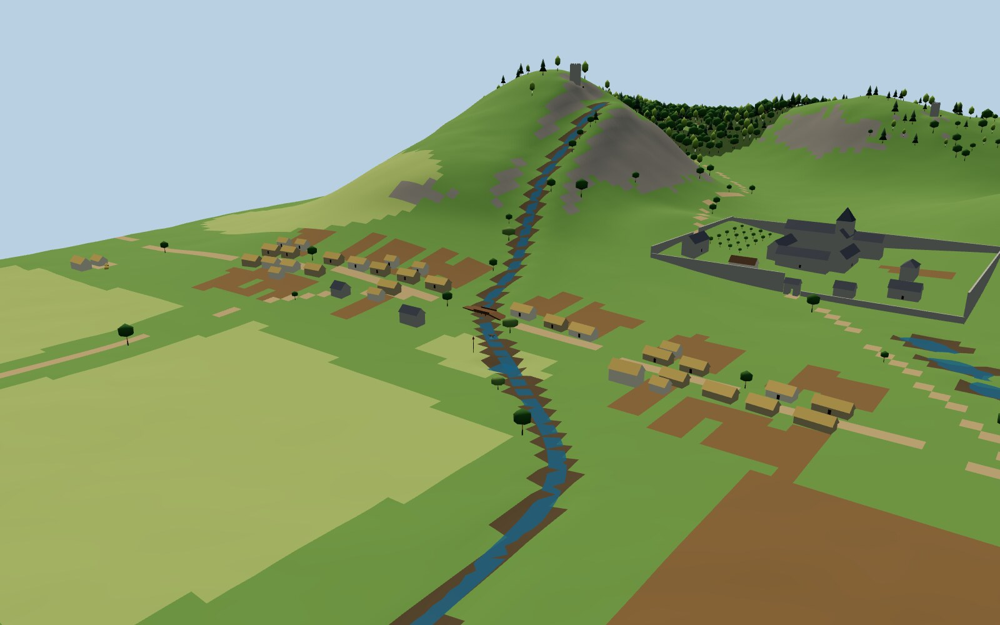

# Ashford Vale: a medieval world, ready to build in 3D

*Where the old ford became a kingdom's heart.*



Ashford Vale is a complete medieval valley, **2 km × 2 km**, measured in real metres.
A castle sits on a mount, guarded on three sides by a horseshoe of hills. Below it lie a walled
market town, three villages, an abbey, mills, open-field farmland, forests and a river. Every
house has a family, every road goes somewhere, and every number in this folder lines up with
every other one.

You **do not need to be a cartographer** to use it. This guide explains everything from
"what is a contour line?" to "which box do I tick in Unreal".

| | |
|---|---|
|  |  |
|  |  |

*Screenshots of the included 3D blockout model. Everything you see comes from the same data as the blueprint.*

---

## Contents

1. [What's in the box](#1-whats-in-the-box)
2. [The 5-minute start: see it in 3D](#2-the-5-minute-start-see-it-in-3d)
3. [How to read the blueprints (for non-cartographers)](#3-how-to-read-the-blueprints)
4. [Building the world in your engine](#4-building-the-world-in-your-engine): Blender · Unreal · Unity · Godot
5. [Placing your own models from the data](#5-placing-your-own-models-from-the-data)
6. [Ground layers, trees and water](#6-ground-layers-trees-and-water)
7. [The story of Ashford Vale](#7-the-story-of-ashford-vale)
8. [Your first walk & quest hooks](#8-your-first-walk--quest-hooks)
9. [Make it yours: rename, reshape, rebuild](#9-make-it-yours)

---

## 1. What's in the box

| Folder / file | What it is | Use it for |
|---|---|---|
| `blueprints/01_master_site_plan` (.svg/.png) | The whole vale: contours, every building, roads, fields, forests, 32 numbered landmarks, legend, story | Your master reference. Print it, pin it up. |
| `blueprints/02_castle_detail` | Ashford Castle at large scale, every building numbered with its size | Building the castle |
| `blueprints/03_town_detail` | The walled town, all 359 buildings numbered | Building the town |
| `model/ashford_vale_blockout.glb` | **The whole world as one 3D file**: terrain, 518 buildings, walls, bridges, water, 7 000+ trees, props | Import into Blender / Unreal / Unity / Godot and start building on top |
| `model/ashford_vale_preview.glb` | Lighter version (coarser terrain, half the trees) | Quick previews, web, slower computers |
| `terrain/heightmap_2049.png` | 16-bit heightmap, **1 pixel = 1 metre**, black = 0 m, white = 256 m | Terrain in Unity, Blender, Godot, World Machine, Gaea… |
| `terrain/heightmap_2049.r16` | Same, as RAW 16-bit little-endian | Unity's terrain importer |
| `terrain/heightmap_2017_unreal.png` | Same land resampled to Unreal's preferred size | Unreal Landscape |
| `terrain/masks/*.png` | 8 ground-cover masks (grass, meadow, farmland, forest floor, rock, mud, dirt road, cobblestone) | Painting terrain materials automatically |
| `terrain/ground_colour_preview.png` | What the ground looks like from above, coloured | A satellite-style reference |
| `data/world.json` | **Everything**: buildings, walls, roads, rivers with water heights, fields, crofts, props, trees, landmarks | Scripts and tools, or placing assets precisely |
| `data/buildings.csv` | Every building: ID, name, position, height, size, roof, floors, material, resident, trade | Open in Excel or Google Sheets |
| `data/trees.csv` | Every tree: position, ground height, species, size | Foliage placement |
| `data/CATALOG.md` | The building list as a readable document, grouped by district | Browsing, planning work |
| `viewer/index.html` | A small 3D viewer for the model | Exploring the world in a browser |
| `build.py`, `src/` | The generator that made all of this | Renaming places and rebuilding (section 9) |

---

## 2. The 5-minute start: see it in 3D

The quickest way in is the `.glb` file. It's a standard 3D format that every major tool opens.

**Blender (free):** `File → Import → glTF 2.0 (.glb/.gltf)` → choose `model/ashford_vale_blockout.glb`.
Press `Numpad .` to frame the world, or select any object in the Outliner and press `Numpad .` to fly to it.

You'll see the outliner organised like this:

```
Ashford Vale
├── Terrain              ← the ground (8 materials, one per ground type)
├── Water                ← River Ash, West Brook, Eastmere Water, Castle Moat, ponds
├── Walls                ← castle curtain, inner ward, town wall, abbey precinct…
├── Bridges              ← Ash Bridge (stone, 3 arches), East Bridge, brook bridges
├── Buildings
│   ├── Castle           ← "C-013 Great Tower (the Keep)", "C-018 Great Hall", …
│   ├── Town             ← "T-024 Steward's Hall (your house)", "T-093 House of Avice the thatcher", …
│   ├── Westbrook / Eastmere / Southfold / Abbey / Countryside
├── Props                ← wells, market stalls, standing stones, boats, haystacks, beacons…
├── Trees                ← merged per forest (The Wildwood, King's Chase, hedgerows, orchards…)
└── Landmarks (empties)  ← 32 named markers you can jump to
```

Every building object carries its catalogue data. In Blender, open **Object Properties → Custom Properties**
to see its ID, type, size, floors, material, resident and trade.

> **What "blockout" means:** buildings are simple boxes with the correct footprint, height, roof shape
> and door direction. This is how game studios start a level: get the layout, scale and walking
> distances right first, then swap each box for a detailed model. Since every box is its own named
> object with its pivot at the floor centre, swapping is easy.

---

## 3. How to read the blueprints

### The grid: finding things
The master plan has lettered columns **A–P** and numbered rows **1–16**. Each square is
**128 m × 128 m**, a little more than a football pitch either way. The key says, for example,
*"7 Market Square … I9"*: go to column I, row 9. The edges are also marked in metres (0 to 2048).

### Contour lines: reading height
The thin wavy lines are **contours**. Each line joins points at the same height, like the edge of
a flood that has risen to that level.
- On the master plan they're every **5 m**, with a **bold line every 25 m** (labelled with its height).
- On the castle and town sheets they're every **1 m**.
- **Lines close together = steep.** **Lines far apart = flat or gentle.**
- Small closed rings stacked inside each other = a hill. Peak heights are written next to the peak names.

Light and shadow (a sun from the north-west) are also drawn over the map, so hills look raised.

### Symbols
Everything is explained in the legend on the sheet. The important ones:
- **Rectangles** are buildings at their real footprint. A **small dot** on one side marks the
  **front door**. **Hatched** (diagonal lines) means an important building: church, hall, inn, shop, gatehouse.
- **Circles on walls** are round towers.
- **Double lines** are roads, **dashed double lines** are field tracks, and **dotted lines** are footpaths.
- **Small circles** are trees, drawn at the size of their crown.
- **Long thin strips** inside big outlined blocks are medieval **strip fields**. The fill shows
  the crop: lines for wheat/rye, diagonals for barley, dots for oats or fallow.
- **Dashed rectangles behind cottages** are **crofts**: each family's garden plot.

### Scale and heights
- The scale bar is in metres. Everything is real size: a cottage is about 14 × 7 m, the keep is
  22 × 22 m and 28 m tall, and the market square is 84 × 64 m.
- Heights are **metres above the heightmap's zero**. The valley floor is around 55–70 m, the castle
  plateau 125 m, and Greycrown, the highest summit, about 240 m.

### Directions
North is up. Positions in the data are measured from the **top-left (north-west) corner**:
**x = metres east, y = metres south**. A building's **heading** is the compass direction its
front door faces (0 = north, 90 = east, 180 = south, 270 = west).

---

## 4. Building the world in your engine

There are two ways to get the land into your engine. Pick one:

- **A. Use the .glb as-is.** Terrain, buildings and everything else arrive together, already aligned.
  This is the best way to get started and to block out the level.
- **B. Use the heightmap for a proper engine terrain** (sculptable, paintable, LOD, foliage tools),
  then place buildings from the `.glb` or from the data.

Key numbers for every engine:

| Setting | Value |
|---|---|
| World size | 2048 m × 2048 m |
| Heightmap | `heightmap_2049.png` (16-bit), 2049 × 2049 pixels, 1 m per pixel |
| Height range | 0 m (black) to 256 m (white) |
| Lowest / highest ground | ≈ 54 m / ≈ 240 m |
| Sanity check | The **Keep** is at x 1024, y 554 (map), floor at 124.7 m. **Your house** is at x 1058, y 1126 |

### Blender
**A. glb:** `File → Import → glTF 2.0`. Done. (Blender is Z-up: map x → Blender X, map y → Blender −Y.)

**B. Heightmap terrain:**
1. `Add → Mesh → Grid`. In the redo panel set **X/Y Subdivisions 1024**, **Size 2048**.
2. Add a **Subdivision Surface** modifier (Simple, level 1), then a **Displace** modifier.
3. In Displace: New texture → Image → open `terrain/heightmap_2049.png`. Set its **Color Space to Non-Color**.
   Set **Strength 256** and **Midlevel 0**. Set **Coordinates: UV**.
4. Your ground now matches the `.glb` exactly. To colour it, use `terrain/ground_colour_preview.png` as the
   Base Color (UV-mapped), or mix materials using the masks (section 6).

### Unreal Engine 5
**A. glb:** Drag `ashford_vale_blockout.glb` into the Content Browser (UE 5.x imports glTF natively), then
drag it into the level. It may import as many separate actors; that's expected.
glTF is in metres and Unreal is in centimetres: the importer converts automatically. Check that the
Keep's tower is about 28 m tall.

**B. Landscape:**
1. **Landscape mode → Manage → New → Import from File** → `terrain/heightmap_2017_unreal.png`.
2. Set **Location 0, 0, 12800** and **Scale X 101.59, Y 101.59, Z 50**.
   *Why:* 2016 gaps × 101.59 cm = 2048 m wide. Z scale 50 gives a 256 m height range. The +128 m
   lift (12 800 cm) makes 0 on the map equal to Z = 0 in the level, so data heights work directly.
3. **Material layers:** create one Landscape layer per mask (grass, meadow, farmland, forest_floor, rock,
   mud, dirt_road, cobblestone). In the import dialog, assign each layer its PNG from `terrain/masks/`.
   (The masks are 2049 px. Resize them to 2017 px in any image editor first, or let Unreal resample.)
4. In Unreal, **X = east, Y = south, Z = up**, which is the same as the map. A data point
   `(x, y, z)` in metres goes to `(x·100, y·100, z·100)` cm.

### Unity
**A. glb:** Unity needs the free **glTFast** package: `Window → Package Manager → + → Add package by name`
→ `com.unity.cloud.gltfast`. Then drag the `.glb` into your Assets and into the scene.

**B. Terrain:**
1. `GameObject → 3D Object → Terrain`. In **Terrain Settings**: Width **2048**, Length **2048**, Height **256**,
   Heightmap Resolution **2049 × 2049**.
2. **Import Raw…** → `terrain/heightmap_2049.r16`. Depth **Bit 16**, Width/Height **2049**,
   Byte Order **Windows**, Terrain Size **2048 × 256 × 2048**.
3. **Check north:** the castle must be at the **far (+Z) end**, about Z ≈ 1450, with the town
   nearer Z ≈ 970. If they're the other way round, re-import with **Flip Vertically** ticked.
4. Map → Unity: `position = (x, z, 2048 − y)`, `rotation Y = heading`. Unity's +Z points north here.
5. Paint terrain layers by hand, using `ground_colour_preview.png` and the masks as reference.
   (Importing splatmaps automatically needs a small editor script. The masks are ready for it.)

### Godot 4
**A. glb:** Copy the `.glb` into your project and drag it into a scene. Godot uses the same axes as glTF:
`position = (x, z, y)`, `rotation.y = −deg_to_rad(heading)`.

**B. Terrain:** Use the free **Terrain3D** add-on. Import `heightmap_2049.png` with a height scale of 256,
then use the masks for its texture layers.

### World Machine, Gaea, Houdini, or other tools
Import `heightmap_2049.png` as a 16-bit heightfield covering 2048 m × 2048 m × 256 m. Erode or detail it
as you like, but keep the flat pads under the town, villages, castle plateau and roads.

---

## 5. Placing your own models from the data

When you have real models (a cottage, a church, a tower…), you can place them exactly where
the boxes are. Each row of `data/buildings.csv` gives you:

| Column | Meaning |
|---|---|
| `id` | Unique ID, matches the numbers on the blueprints (C = castle, T = town, W = Westbrook, E = Eastmere, S = Southfold, A = abbey, O = countryside) |
| `name`, `type` | e.g. "House of Avice the thatcher", `shop` |
| `x`, `y` | Centre of the footprint, metres east / south of the north-west corner |
| `z` | Floor level: lowest ground under the building, sunk 0.3 m so there are no gaps |
| `heading` | Compass direction the **front door** faces |
| `w`, `d` | Footprint: width (side to side, as seen from the front) and depth (front to back) |
| `h`, `roof`, `roof_h` | Wall height, roof style (gable, hip, crenel, cone, spire, flat), roof height |
| `floors`, `material` | Storeys and main material (stone, timber, wattle) |
| `resident`, `trade` | Who lives there and what they do, for quests, signs and NPCs |

**The one rule for your models:** make each one so that at rotation 0 **its front door faces north**,
with its pivot at the **centre of its floor**. Then:

| Engine | Position | Rotation |
|---|---|---|
| Blender | `(x, −y, z)` | Z = −heading |
| Unreal | `(x·100, y·100, z·100)` cm | Yaw = heading |
| Unity | `(x, z, 2048 − y)` | Y = heading |
| Godot / glTF | `(x, z, y)` | Y = −heading (radians) |

Walls (`world.json → walls`) are lists of straight segments `[x0, y0, x1, y1]` with a height and
thickness. They're ideal for a spline or modular-wall tool. Roads come as point lists with ground
heights, ready for a road or spline tool.

---

## 6. Ground layers, trees and water

**Ground masks** (`terrain/masks/`) are greyscale images, 1 pixel per metre. White = 100 % of that
ground type. At every pixel the eight masks add up to 100 %:

`grass` (default) · `meadow` (pasture, greens, fallow strips, river meadows) · `farmland` (crop strips,
cottage gardens) · `forest_floor` · `rock` (cliffs, steep slopes, quarry) · `mud` (river banks, shores)
· `dirt_road` (roads, tracks, farmyards) · `cobblestone` (town streets, market square, castle courtyard).

**Trees:** `data/trees.csv` lists all 7 000+ trees with species (oak, beech, ash, birch, pine, willow,
alder, hawthorn, apple, pear, plum) and height. Most foliage tools can scatter from a point list.
The `group` column tells you which forest each tree belongs to.

**Water:** every river point in `world.json` has its own **water height**, and it always runs downhill.
The Mere, the moat and the ponds each have one `level`. Put a flat water plane at that height, or
use the water meshes in the `.glb`.

| Water | Water height |
|---|---|
| River Ash | about 139 m where it leaves the hills (north-east) down to 56 m where it leaves the map (south-west) |
| Castle Moat | 122.5 m |
| Eastmere Water | 63 m |

---

## 7. The story of Ashford Vale

> *Long before the castle, travellers waded the River Ash at a shallow ford, and a village grew
> beside it. The Nine Maidens were already old on the hill above.*

**The Ford.** The vale got its name from **the Old Ash Ford** (landmark 23), where the river runs wide
and shallow over a bed of stones. Drovers, pilgrims and pedlars crossed here for centuries, and
where people cross, people trade. The stepping stones are still there, below the Southfold track.

**The Stones.** On the saddle between Raven Hill and Greycrown stands a ring of nine weathered stones,
**the Nine Maidens** (22). No one remembers who raised them. Shepherds say the stones walk down to
the river on midsummer night to drink, and that is why the river never floods the town.

**The Castle.** When raiders came over the Greycrown Hills, the first Baron saw what the land
offered. On **Castle Mount** the hills curl around in a horseshoe: Raven Hill to the west,
Greycrown to the north, Beacon Hill to the east. From the top of the mount you can see every road
into the vale. He raised a wooden tower there, and his grandson replaced it with the **Great Tower**
in stone (1), then ringed it with a curtain wall, eight towers and a moat fed by the Lady's Spring (5).
The **Postern Gate** (6) leads out to the ridge paths and the four **watch-fires** (18–21). In a single
evening the Greycrown Beacon can be lit and seen from every rooftop in the vale.

**The Town.** The ford-village moved up the slope to sit under the castle's protection. It became
**Ashford**, a walled market town of about 360 houses, four gates and a market square (7). There you'll
find the Market Hall, the Market Cross, the stocks and a dozen stalls. **St. Michael's Church** (8) has
the tallest spire in the vale. The **Guildhall** (9) is where the merchants argue and the town court sits.
**The Ford & Crown** (10) is where everyone else argues. Every house in the town has a resident and a
trade: bakers, coopers, fletchers, goldsmiths, an apothecary, a barber-surgeon…

**The Abbey.** Monks came for the quiet and stayed for the wool. **St. Hilda's Abbey** (13) is the
second power in the vale, after the Baron. It has a church with a crossing tower, a cloister, an
infirmary, a guest house for pilgrims on the Pilgrim Way, three fishponds (14) for fast days, and
its own field, the Abbey Furlong.

**The Land.** Three great open fields feed everyone, farmed in rotation: this year the **South Field**
is in winter wheat and rye, the **East Field** in barley, oats, beans and peas, and the **West Field**
is fallow, grazed by Westbrook's sheep. Every family farms a scatter of strips in all three fields,
so good land and bad are shared fairly. The **watermill** (24) grinds the grain, and the miller keeps
one sack in sixteen, which everyone grumbles about. The **windmill** (26) works when the river is
low. The **tannery** (25) is kept downstream and outside the walls, for obvious reasons.

**The Villages.** **Westbrook** (15) sits where the West Brook crosses the King's Road, with a green,
a maypole, a pond and the little chapel of St. Wulfric. **Eastmere** (16) fishes the reed-fringed
mere and grows apples. **Southfold** (17), across Ash Bridge, is a hamlet of shepherds built around a
great stone sheep pen.

**The Wild.** **The Wildwood** in the north-west is old, dark and full of charcoal burners (30).
**King's Chase** in the north-east is the royal deer forest, with a hunting lodge (29) that the
King has not visited in eleven years.

**You.** You are **the Steward**: the Baron's hand in the vale, keeper of the accounts, settler of
disputes, and the one people come to when something goes wrong. Your house, **Steward's Hall** (11),
faces the market square. From your window you can see the Market Cross, the church spire and,
on clear days, the Greycrown Beacon.

---

## 8. Your first walk & quest hooks

**The Steward's first walk.** This route visits the whole vale in about 4 km. It's a good first
"playtest" of the world's scale, on foot or as a camera fly-through:

1. Start at **Steward's Hall (11)** → cross the **Market Square (7)** → look up at **St. Michael's (8)**.
2. Leave by the **North Gate (12)** and climb **Castle Way**'s switchbacks to the **Barbican (4)**,
   cross the drawbridge, and enter through the **Great Gatehouse (3)**.
3. Climb the **Keep (1)**. Find all four watch-fires from the top.
4. Leave by the **Postern (6)** and take the ridge path past **the Nine Maidens (22)** to the
   **Raven Hill watchtower (18)**.
5. Drop down the Pilgrim Way to **St. Hilda's Abbey (13)** and on to **Westbrook (15)**.
6. Follow the Ford Track through the West Field to **the Old Ash Ford (23)** and wade across.
7. Walk through **Southfold (17)**, back over **Ash Bridge (31)**, past the **watermill (24)**,
   and in through the **River Gate**, home.

**Quest hooks** (all the places and people exist in the data):
- **The Missing Sack.** The miller swears the watermill's tally is honest. The bakers of Ashford
  (find them in `buildings.csv`) swear it isn't.
- **Dark Beacon.** The Beacon Hill watchtower failed to answer last night's signal. The watchman is gone.
- **The Walking Stones.** It's midsummer eve, and someone has moved one of the Nine Maidens.
- **Tithe Trouble.** The abbey and the town both claim the Abbey Furlong's harvest. The Guildhall
  wants the Steward to decide.
- **Poacher's Moon.** Deer are disappearing from King's Chase. The charcoal burners know more than they say.
- **The Drowned Bell.** Fishers on Eastmere Water hear a bell under the water at dusk.
- **Tourney Season.** Prepare the tiltyard, house the knights at the Ford & Crown, and keep the peace.
- **Flood Warning.** The River Ash is rising. Will the Ash Bridge hold, and what is buried at the old ford?

---

## 9. Make it yours

Open `src/config.py`. Every place name lives there: the realm, the castle, the town, villages,
rivers, hills, forests, the inn, and **you** (`YOU = "The Steward"`, `YOUR_HOUSE = "Steward's Hall"`).
Change them, then rebuild:

```bash
pip install numpy pillow
python3 build.py        # about 30 seconds: rewrites blueprints, terrain, data and 3D models
```

`SEED` in the same file gives you a different arrangement of houses, residents and trees, plus terrain
noise, while keeping the overall layout.

To change the layout itself (move the castle, add a village, reroute a road), edit `src/layout.py`.
Every place is a few readable lines of coordinates in metres. The terrain, blueprints, masks and
3D model all update to match.

The blueprint PNGs are rendered from the SVGs. Open any `.svg` in a browser or Inkscape for a
crisp, zoomable version.

### Technical notes
- Coordinates: origin at the map's north-west corner, x east, y south, z up, all in metres. The `.glb`
  uses glTF axes (+X east, +Y up, +Z south) with the same origin, so a map point `(x, y, z)` is glTF `(x, z, y)`.
- glTF colours are linear PBR base colours, and each material name says what it is
  (`Roof thatch`, `Stone wall`, `Terrain farmland`…). Swap them for real textures. The terrain has UVs
  that repeat every 8 m.
- The heightmap was generated, not scanned. Rivers are carved so their water always runs downhill,
  and roads are cut and filled into slopes with their own grade.
